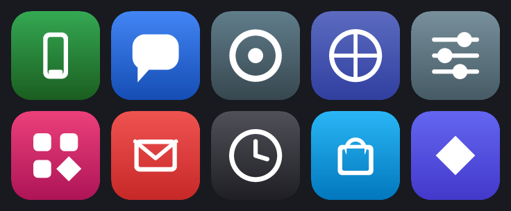

# Systema

Тема іконок «Systema» для Android у форматі icon pack (Nova Launcher та сумісні лончери). Перевірено для Samsung Galaxy S25 Ultra.



## На Galaxy S25 Ultra

- **Через Nova Launcher (чи інший сумісний лончер):** встановіть APK теми, потім у Nova Launcher → Налаштування → Вигляд → Тема іконок виберіть «Systema Theme».
- **Через рідний One UI Home:** сторонні icon pack не застосовуються напряму — використовуйте Good Lock → Theme Park (офіційний механізм Samsung).

## Збирання APK

1. Відкрийте папку репозиторію в Android Studio.
2. Build → Build Bundle(s) / APK(s) → Build APK(s).
3. Встановіть отриманий `app-debug.apk` на телефон.

## Структура

- `app/src/main/AndroidManifest.xml` — точка входу теми (категорія `com.teslacoilsw.launcher.THEME`).
- `app/src/main/res/appfilter.xml` — зіставлення компонентів застосунків (Samsung, Google, AOSP) з іконками теми.
- `app/src/main/res/drawable-*dpi/` — іконки у 5 щільностях (mdpi … xxxhdpi).
- `tools/generate_icons.py` — генератор іконок, чистий Python без залежностей.

## Підтримувані застосунки

Телефон, Повідомлення, Камера, Браузер (Samsung Internet / Chrome / Firefox), Налаштування, Галерея, Пошта (Gmail), Годинник, Магазин (Play / Galaxy Store).

## Регенерація іконок

```bash
python3 tools/generate_icons.py
```

Скрипт перестворить усі PNG у `app/src/main/res/drawable-*dpi/` та `preview.png`.
